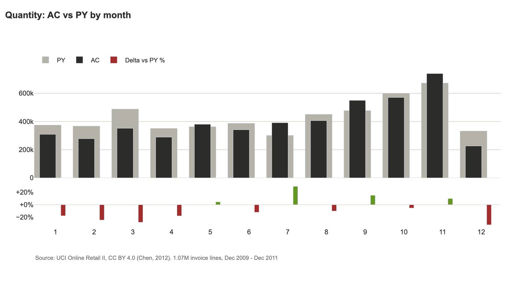

# ibcs-plotly

Interactive [IBCS](https://www.ibcs.com/)-compliant business charts on Plotly, with optional Streamlit components.

IBCS (International Business Communication Standards) fixes a small set of
rules for business reports: current-period and comparison-period values get
consistent colors, variance gets its own consistent colors, composition
charts are sorted bars instead of pies, and comparable small multiples share
one scale. This library gives you those chart types as plain functions that
return a `plotly.graph_objects.Figure`, plus a thin Streamlit layer for KPI
cards and the AC/PY/variance legend.

There's an existing IBCS-inspired Python package,
[clean_business_chart](https://github.com/MarcelW1323/clean_business_chart),
built on matplotlib. This one targets interactive dashboards (Plotly +
Streamlit) rather than static reports.

## Install

```bash
pip install ibcs-plotly            # core: plotly + pandas + numpy
pip install ibcs-plotly[streamlit] # + Streamlit KPI cards / legend
```

## Quick example

```python
from ibcs_plotly import grouped_column, compare_periods

df_ac, df_py, py_year = compare_periods(df, period_col="year", current=2026)

fig = grouped_column(
    ac=df_ac.groupby("month")["revenue"].sum(),
    py=df_py.groupby("month")["revenue"].sum(),
    labels=month_names,
)
fig.show()
```

See [`examples/streamlit_demo.py`](examples/streamlit_demo.py) for a full
dashboard on synthetic data — run it with:

```bash
pip install -e ".[streamlit]"
streamlit run examples/streamlit_demo.py
```

## Plan charts with AI (MCP)

`ibcs_plotly.planner` profiles a dataset, works out what can be calculated
(variance AC-PY, variance %, share, rank, trend, rolling, YTD), and emits a
plan of IBCS chart specs that a developer - or an agent - can build from.
An MCP server exposes this to any MCP-capable assistant.

The operator decides how much of the data the AI may see; the AI can ask for
less per call, never more:

| Tier | The AI receives |
|---|---|
| `SCHEMA` | column names, dtypes, inferred roles (measure / dimension / time / period / id) |
| `STATS` | + null %, min/max/mean, date ranges, top categories |
| `SAMPLE` | + a small random row sample |
| `FULL` | + all rows (capped). PII columns are masked in SAMPLE/FULL by default |

```bash
pip install "ibcs-plotly[mcp]"
IBCS_MCP_DATA_DIR=./data IBCS_MCP_MAX_TIER=STATS ibcs-plotly-mcp
```

Tools: `load_dataset`, `describe_dataset`, `plan_charts`, `llm_context_bundle`,
`check_chart`, `render_chart`.
Charts are always rendered locally on the full data; the AI only gets back a
file path. Without MCP, the same pieces work as a library:

```python
from ibcs_plotly.planner import build_plan, render_spec
plan = build_plan(df, tier="STATS")
print(plan.to_markdown())
render_spec(df, plan.charts[0]).show()
```

### LLM-ready export and compliance check

```python
from ibcs_plotly.planner import llm_context, estimate_tokens, to_json
ctx = llm_context(df, tier="STATS", goal="revenue by region")  # instructions + data view + plan
print(estimate_tokens(ctx))        # check it fits the prompt before pasting
prompt_payload = to_json(ctx)

from ibcs_plotly import check_figure
for f in check_figure(fig):        # works on any Plotly figure
    print(f.severity, f.rule, f.message)
```

`check_figure` flags pies, 3D, truncated bar axes, unshared small-multiple
scales, wrong AC/PY/variance colors, too many categories and color noise.
It checks only what is mechanically verifiable from the figure; it cannot
judge titles, units or message quality.

## Tested on real data



Every chart above and below is the planner's own output for a real public dataset
(nothing hand-drawn); each image carries its source and licence.

| Chart | Dataset | What it shows |
|---|---|---|
| [AC vs PY by month](docs/images/real/retail_months.png) | UCI Online Retail II | 2011 against the same dates of 2010 |
| [Bars by country](docs/images/real/retail_countries.png) | UCI Online Retail II | ranked, AC over PY |
| [Daily trend](docs/images/real/taxi_daily.png) | NYC taxi, Jan 2024 | daily grain because the data spans one month |
| [Small multiples](docs/images/real/taxi_vendors.png) | NYC taxi, Jan 2024 | one scale across panels |
| [Bars by country](docs/images/real/co2_countries.png), [variance](docs/images/real/co2_variance.png) | Our World in Data CO2 | "World" and regional totals excluded |
| [Row counts by district](docs/images/real/chicago_events.png) | Chicago crimes | no numeric column, so it counts events |
| [AC vs PY by month](docs/images/real/seattle_months.png) | Seattle weather | 2015 against 2014 |

### What was tested

The test suites are kept out of this repository (unit tests, seed data, the downloaded datasets, the
harnesses and their reports all live in git-ignored `tests/` and `testdata/`), and were run locally before
release. CI runs lint, an import check of every module, and an end-to-end smoke test of plan, render and lint.

| Suite | Data | Checks | Covers |
|---|---|---|---|
| Unit tests | small crafted frames | 79 | roles, tiers, plans, rendering, lint, MCP session, HTML escaping |
| Synthetic harness | 52 generated files | 2,291 | edge cases: negatives, nulls, infinities, 500k rows, 200 columns, a dozen date formats, hidden and obvious PII, prompt-injection text, path escapes, bad files |
| Real-data harness | 14 open datasets (below) | 514 | all four exposure tiers; no cell text at SCHEMA; small groups hidden at STATS; PII never exposed; chart totals re-computed with plain pandas; plausibility review |
| MCP end to end | stdio server | 1 script | all six tools, tier ceiling, path-traversal refusals |

| Dataset | Licence | Rows | Stresses |
|---|---|---|---|
| UCI Online Retail II | CC BY 4.0 | 1,067,371 | cancellations and returns, mixed-type invoice ids, missing customer ids |
| NYC TLC yellow taxi, Jan 2024 | open data | 2,964,624 | stray dates from 2002/2009/2023, negative fares, float counts with NaN |
| NYC 311, Jan 2024 | public domain | 100,000 | street addresses, free text, many sparse columns |
| Chicago crimes 2023 (sample) | public domain | 100,000 | code columns, coordinates, no numeric measure |
| Our World in Data CO2 | CC BY 4.0 | 50,411 | 79 columns, heavy missing data, regional totals beside countries |
| Movies, cars, gapminder, stocks | vega-datasets | 406 to 3,201 | text dates, JSON, nulls |
| Seattle weather, flights, titanic, penguins, diamonds | NOAA, seaborn-data | 144 to 53,940 | month names, small groups, no time column |

Real data found problems synthetic data did not, all fixed and covered by unit tests: code columns such as
`zip`, `district` and `iucr` read as measures or dates; invoice ids with cancellation prefixes turned
into numbers and blanked; latitude and longitude summed; regional totals double counted; stray dates
picked as the comparison year; a part-year compared with a full year; monthly lines for one month of data;
street addresses missed as PII; ID-like columns charted as categories.

Not covered: charts are never judged for meaning (only for the rules listed above), PII detection
is heuristic, and derived measures such as quantity times price are not built for you.

Charts built from CC BY datasets credit their sources in the image:
Our World in Data, "CO2 and Greenhouse Gas Emissions" (CC BY 4.0);
Chen, D. (2012), "Online Retail II", UCI Machine Learning Repository (CC BY 4.0).

## What's included

- `grouped_column`, `horizontal_bar`, `variance_waterfall`, `small_multiples`,
  `line_comparison`
  — chart primitives, framework-agnostic
- `compare_periods`, `safe_delta_pct` — period-over-period comparison helpers
- `IBCSTheme` — colors/layout as a dataclass you can override
- `ibcs_plotly.streamlit_ext` — `kpi_card`, `legend_html`, `inject_theme_css`

- `ibcs_plotly.planner` — dataset profiling, exposure tiers, chart plans, spec renderer, LLM export
- `ibcs_plotly.check_figure` — IBCS compliance checker for any Plotly figure
- `ibcs_plotly.mcp_server` — MCP server (`ibcs-plotly-mcp`) for AI-assisted chart planning

Not in scope yet: matplotlib/other backends, PDF/PPT export.

## License

MIT
